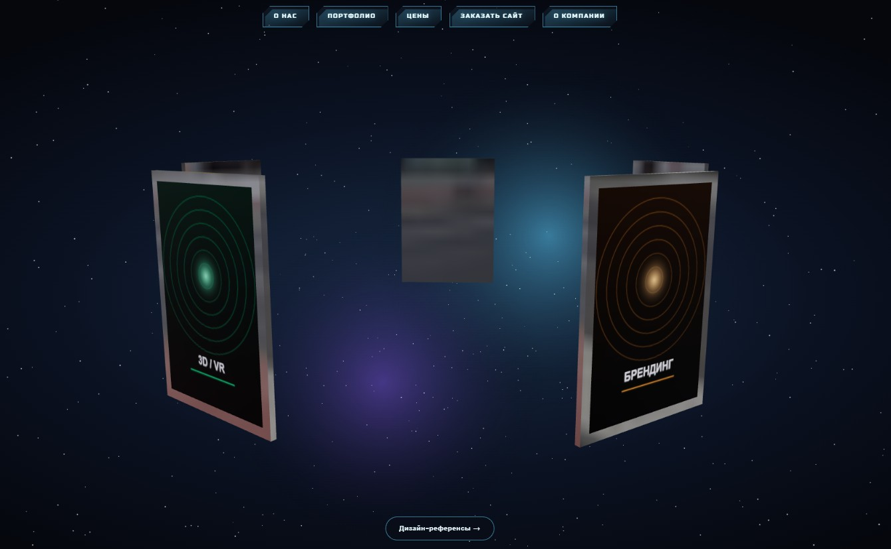
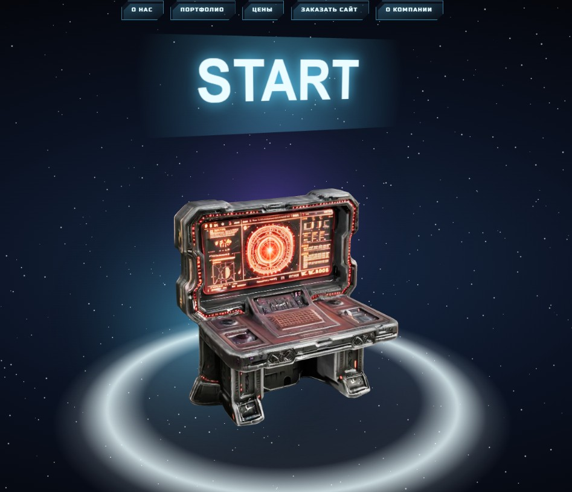
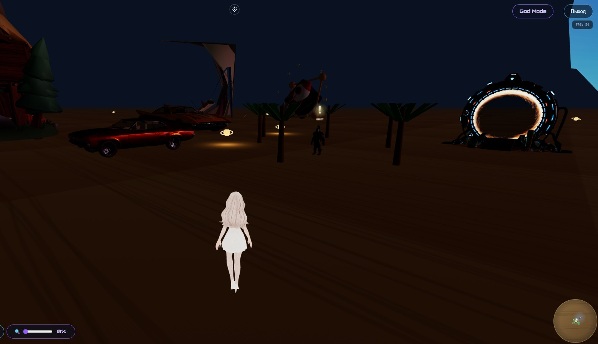
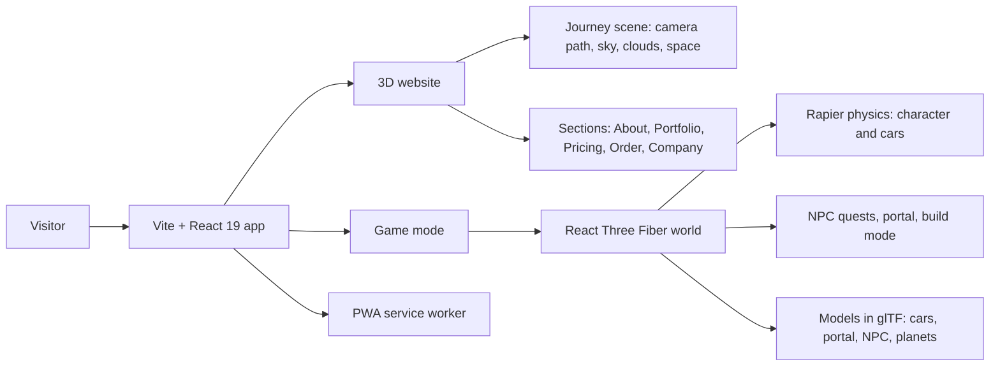
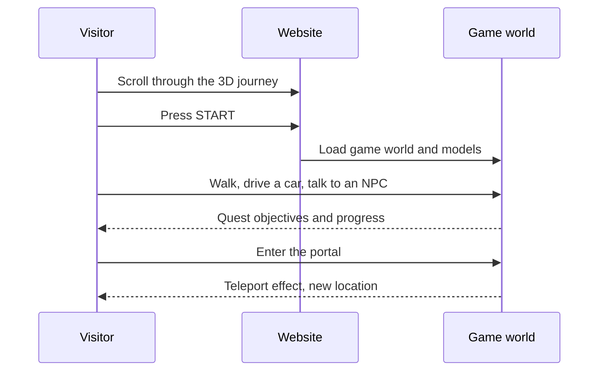

# Future3D

An immersive 3D website with a playable 3D world inside it. Scroll through a journey from the sky to space, press **START**, and walk, drive and complete quests in a browser game, all in one TypeScript app.

> **Status: prototype demo.** The site and the game run in the browser. Content, quests and multiplayer are still in progress.



## What it is

Future3D is a landing site for a 3D web studio, built as a 3D experience instead of a flat page. A scroll-driven camera takes the visitor through the sky, clouds and space. A **START** console opens a game world rendered in the same page.

| Landing | Start console | Game world |
| --- | --- | --- |
|  |  |  |

## Features

### 3D website
- Scroll-driven camera journey through sky, clouds and space (Earth, solar system, satellites, UFOs).
- Sections: About, Portfolio, Pricing, Order a site, Company.
- Smooth scrolling, particles, bloom and other post-processing effects.
- Installable PWA with auto-updating service worker.

### Game inside the site
- Third-person character you can walk, run and jump with.
- **Cars you can drive:** get in and out with `Enter` on PC or a tap on mobile.
- **Quests:** NPCs with quest markers, quest objectives and a quest UI.
- **Portal:** step into the portal to teleport, with a visual effect.
- **Build mode:** pick up, move and place objects in the world.
- **God Mode:** free flight for exploring the map.
- Day and night sky, minimap, music player, graphics settings.
- Mobile controls with a dynamic joystick and a rotate-device prompt.

### Controls

| PC | Action | Mobile | Action |
| --- | --- | --- | --- |
| `WASD` / arrows | Move | Left joystick | Move |
| `Shift` | Run | Tap a car | Get in or out |
| `Space` | Jump | Tap an object or NPC | Interact |
| `Enter` | Get in or out of a car | "Down" button | Descend (God Mode) |
| Mouse click | Interact | | |
| `Ctrl` / `C` | Descend (God Mode) | | |

## Architecture





## Tech stack

| Area | Tools |
| --- | --- |
| Language and build | TypeScript, Vite |
| UI | React 19, Tailwind CSS, Radix UI |
| 3D | Three.js, React Three Fiber, Drei, postprocessing |
| Physics and controls | Rapier, Ecctrl (character and vehicle controller) |
| Animation | GSAP, Framer Motion, Lenis (smooth scroll) |
| State | Zustand |
| Models | glTF/GLB, Draco and Meshopt compression via glTF-Transform |
| PWA | vite-plugin-pwa |

A full audit of all 72 dependencies is in [docs/MODULES.md](docs/MODULES.md) (in Russian).

## Getting started

Requirements: Node.js 18 or newer.

```shell
git clone https://github.com/Godblessmylife/WEBSITE
cd WEBSITE
npm install
npm run dev
```

Open the local address printed by Vite.

| Command | Description |
| --- | --- |
| `npm run dev` | Start the dev server |
| `npm run build` | Production build |
| `npm run preview` | Preview the production build |
| `npm run typecheck` | Type-check with TypeScript |

## Project structure

```
Future3D/
  src/
    scenes/       3D journey: camera path, sky, clouds, Earth, solar system, satellites, UFOs
    components/   Page sections and UI: Nav, About, Portfolio, Pricing, Contact
    game/         Game world: character, cars, NPC quests, portal, minimap, build mode
    models/       glTF models
    hooks/        Shared hooks
    effects/      Post-processing
  public/         Icons, manifest, images
docs/
  MODULES.md      Dependency audit
```

## Configuration

Copy `.env.example` to `.env` and fill in your own values. Never commit real keys. The file lists payment gateway settings, which are placeholders for a planned payment feature.

## Roadmap

- More quests and locations.
- Multiplayer (the Colyseus client library is already a dependency).
- Backend for ordering and payments (the `Future3D/api` folder is reserved for it).
- Asset optimization for faster first load.

## Author

Ioannes Avakian, senior software engineer (full-stack, distributed systems, blockchain).
Contact: masterofscience1993@gmail.com
Telegram t.me/web3elchapo
